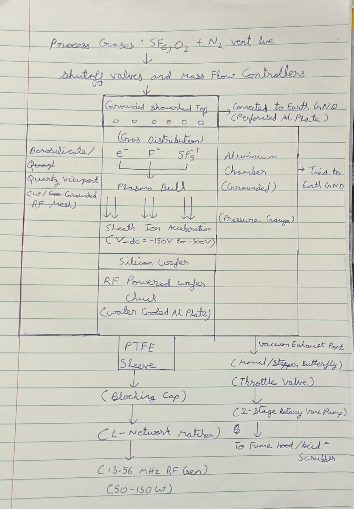

# Low-Cost Capacitively Coupled Plasma Reactive Ion Etching (CCP-RIE) Tool Design

**Author:** Arman Patel 
**Repository:** `ArmanPatel_HackerFabIITB_Submission`  
**Video Walkthrough:** https://www.youtube.com/watch?v=IYm8GrikoJs

---

## 1. Overview & Design Motivation

This document presents a high-level engineering design for a low-cost, modular **Capacitively Coupled Plasma Reactive Ion Etching (CCP-RIE)** system tailored for the **HackerFab IITB** fabrication line.

### Motivation & Fit Within HackerFab IITB
Currently, HackerFab IITB's toolset (`litho-v1`, `sputter-v2`, `tube-furnace`, `dopant`, and `thermal-evaporator-v1`) covers UV photolithography, thermal oxidation, doping, and thin-film metal deposition. However, transferring patterns into silicon or silicon dioxide (SiO₂) currently relies either on wet chemical etching (such as buffered Hydrofluoric Acid, HF, which is hazardous and etches isotropically/sideways under the mask) or physical scratching (such as removing backside oxide during **MOSCAP** fabrication).

Introducing a dry plasma RIE system solves two critical fabrication bottlenecks:
1. **Anisotropic (Vertical) Pattern Transfer:** Enables micron-scale vertical etching of Polysilicon gates and SiO₂ contact windows without sideways undercutting, which is required for scaling **Self-Aligned NMOS Transistors**.
2. **Elimination of Liquid HF Handling:** Allows safe, dry etching of SiO₂ (including backside oxide removal in **MOSCAP** and **NMOS** flows) using benign bottled SF₆ gas that only becomes reactive inside a sealed vacuum chamber.

### Target Specifications & Design Approach
To keep the machine affordable and buildable in a student lab while matching the global HackerFab Plasma Etcher Standard Operating Procedure (SOP), I designed around the following target specifications:
* **Sample Compatibility:** Cleaved silicon dies (1 cm × 1 cm to 2 cm × 2 cm) up to a 100 mm (4-inch) wafer.
* **Operating Pressure Range:** 30–150 mTorr (0.03–0.15 Torr), with a base pressure < 10 mTorr.
* **RF Power & Frequency:** 50–150 W at 13.56 MHz (or 14 MHz Amateur Radio HF band equivalent).
* **Process Gases:** SF₆ (5–30 sccm) for Silicon/Polysilicon/SiO₂ etching, O₂ (2–30 sccm) for radical enhancement and photoresist stripping ("ashing"), and N₂ for moisture/byproduct purging and venting.

---

## 2. Theory of Operation: How RIE Works from First Principles

Unlike wet chemical etching (which is purely chemical and isotropic, etching equally in all directions) or physical ion milling (which is purely physical, slow, and non-selective), **Reactive Ion Etching (RIE)** combines **chemical surface reactions** with **directional physical ion bombardment** to achieve fast, selective, and vertical (anisotropic) etching.

### Architectural Choice: CCP-RIE vs. ICP-RIE

| Feature | CCP-RIE (Capacitively Coupled Plasma) | ICP-RIE (Inductively Coupled Plasma) |
| :--- | :--- | :--- |
| **Plasma Generation Mechanism** | Oscillating electric field between two parallel metal plate electrodes inside the chamber (acts like a capacitor). | Oscillating magnetic field induced by an external RF coil around a dielectric window, plus a second RF supply on the bottom wafer chuck. |
| **Control of Density vs. Energy** | **Coupled:** A single RF generator controls both plasma density (radical/ion flux) and ion bombardment energy (DC self-bias). | **Decoupled:** Top inductive coil independently controls plasma density; bottom CCP chuck controls ion bombardment energy. |
| **Wafer Damage Risk** | Moderate (high RF power increases sheath voltage and ion impact energy). | Low (can generate high-density plasma at low sheath bias voltage). |
| **Cost & Mechanical Complexity** | **Low:** Requires 1 RF supply, 1 matching network, and a simple machined aluminum chamber. | **High:** Requires 2 synchronized RF supplies, 2 matching networks, and a fragile quartz/ceramic bell jar. |

**Why I Chose CCP-RIE:** For a low-cost student fab fabricating micron-scale **MOSCAP** and **NMOS** devices, **CCP-RIE** is the practical choice. It eliminates the second RF generator, dual matching network, and ceramic dome required by ICP-RIE, cutting cost and complexity while easily meeting our etch rate and anisotropy requirements.

---

### First-Principles Physics & Chemistry of CCP-RIE

#### A. How the Plasma is Generated (Glow Discharge)
1. The vacuum chamber is pumped down to < 10 mTorr to remove atmospheric air and water vapor, then backfilled with a precursor gas such as Sulfur Hexafluoride (SF₆) at 50–100 mTorr.
2. A high-frequency alternating voltage (13.56 MHz RF) is applied to the bottom wafer electrode (cathode), while the top electrode and metal chamber walls are connected to Earth Ground (anode).
3. Free electrons in the gas are rapidly oscillated back and forth by the alternating RF electric field, gaining kinetic energy. Because electrons have tiny mass, they absorb almost all the RF energy and slam into neutral SF₆ molecules, causing three key processes:
   * **Ionization:** Knocking bound electrons off neutral molecules to create positively charged ions and additional free electrons, sustaining the plasma:  
     `SF₆ + e⁻ → SF₅⁺ + F + 2e⁻`
   * **Dissociation:** Breaking molecular bonds to generate electrically neutral, chemically hyper-reactive fluorine free radicals:  
     `SF₆ + e⁻ → SF₅* + F* + e⁻`
   * **Excitation & Relaxation:** Exciting bound electrons to higher energy states; when they drop back down, they emit photons, producing the characteristic purple/blue plasma glow.

#### B. Why Ions Accelerate Towards the Wafer (DC Self-Bias & Plasma Sheath)
1. **Electron vs. Ion Mobility:** Electrons are thousands of times lighter than heavy SF₅⁺ ions. At 13.56 MHz, nimble electrons rapidly rush into the electrodes during the positive half-cycle of the RF wave, whereas massive positive ions can barely move before the field reverses.
2. **Charge Trapping via Blocking Capacitor:** The bottom wafer electrode is connected to the RF generator through a **series blocking capacitor**. When a swarm of electrons hits the bottom electrode during the positive RF half-cycle, that negative charge gets trapped on the plate—it cannot drain away to DC ground because the capacitor blocks DC current.
3. **DC Self-Bias (V_dc):** Within microseconds, the bottom electrode charges up to a strong, steady **negative DC voltage** relative to the plasma bulk (typically **-150 V to -400 V**), known as the **DC Self-Bias**.
4. **The Plasma Sheath:** This strongly negative wafer electrode repels free electrons away from the wafer surface, creating a thin, dark, electron-depleted boundary layer right above the wafer called the **plasma sheath**. Positively charged ions (SF₅⁺) wandering into the edge of this sheath feel a strong downward electrostatic pull toward the negatively charged wafer and accelerate straight down (90° normal incidence).

#### C. What Causes Material to Be Etched (Chemical-Physical Synergy)
RIE relies on the synergy between isotropic chemical reactions and directional ion bombardment:
1. **Chemical Reaction (Etching Silicon):** Electrically neutral fluorine radicals (F*) diffuse down to the wafer surface and stick to exposed Silicon (Si). Four fluorine atoms react with a surface silicon atom to form **Silicon Tetrafluoride (SiF₄)**:
   > **Si (solid) + 4 F* (gas) → SiF₄ ↑ (volatile gas)**
   
   Because SiF₄ is a gas at room temperature (boiling point -86°C), it floats away from the wafer surface and is pumped out through the exhaust.
2. **Physical Ion Bombardment (Creating Anisotropy):** Energetic positive ions (SF₅⁺) shoot straight down across the sheath and slam strictly into the horizontal bottom floor of the trench (missing the vertical sidewalls). This vertical bombardment breaks strained Si–Si bonds on the trench floor, clears away surface byproducts, and speeds up the chemical reaction rate with F* by **10x to 100x** compared to the unbombarded vertical sidewalls.
3. **Photoresist Mask Selectivity:** The areas of the wafer that we *do not* want to etch are covered by a patterned stencil of **photoresist** (an organic carbon-based polymer, ~1.5 µm thick). Fluorine radicals react rapidly with Silicon, but react slowly with carbon-based photoresist. While the plasma rains down over the entire wafer, the thick photoresist shield erodes very slowly while the bare, exposed polysilicon or oxide around it is completely etched away.

---

### How Process Parameters Affect the Etch

* **Chamber Pressure (30–150 mTorr):**
  * **Lower Pressure (< 50 mTorr):** Increases the *mean free path* (the distance an ion travels before bumping into another gas molecule). Ions cross the sheath without mid-air collisions and hit the wafer straight on at 90° with high energy → **more vertical (anisotropic) sidewalls**, but slightly slower etch rate and lower mask selectivity (more physical wear on the photoresist mask).
  * **Higher Pressure (> 100 mTorr):** Shortens the mean free path. Ions collide with neutral molecules inside the sheath and scatter at random angles, while the number of neutral F* radicals increases → **faster chemical etch rate and higher selectivity, but more isotropic (sideways undercutting)**.
* **RF Power (50–150 W):**
  * In a CCP-RIE, turning up RF power simultaneously increases plasma density (more F* and SF₅⁺) and increases the negative DC self-bias voltage (|V_dc|).
  * **Higher RF Power:** Increases etch rate and directionality, but excessive power (> 200 W) causes high-energy ions to damage thin underlying gate oxides and overheat/burn the photoresist mask.
* **Gas Chemistry (SF₆, O₂, N₂):**
  * **SF₆:** Primary source of fluorine radicals (F*) and heavy ions (SF₅⁺) for etching Si, Polysilicon, and SiO₂.
  * **Small O₂ Addition (10–20% of SF₆ flow):** Reacts with sulfur/carbon fragments so F* atoms don't recombine back into SF₆, freeing up more F* radicals (boosting etch speed) and helping passivate sidewalls against sideways etching.
  * **Pure O₂ Plasma:** Reacts with organic photoresist to form CO₂ and H₂O ↑ gas, used to strip ("ash") leftover photoresist masks and clean the chamber.

---

### Where RIE Fits in Semiconductor Fabrication (NMOS & MOSCAP Examples)

In semiconductor fabrication, chips are built through repeating loops of **Deposition/Growth → Photolithography (`litho-v1`) → Etching (`CCP-RIE`) → Mask Stripping**:

1. **Example A — Self-Aligned NMOS Transistor Polysilicon Gate Etch:**
   An NMOS transistor acts as a microscopic electrical switch where a positive voltage applied to a **Polysilicon Gate** (sitting on top of a thin 25 nm SiO₂ glass insulator) pulls electrons up to form a conductive bridge connecting the **Source (n⁺)** to the **Drain (n⁺)**. After growing the gate oxide and depositing a blanket 300 nm Polysilicon layer, `litho-v1` patterns a narrow strip of photoresist over the gate region. Our **CCP-RIE** tool then uses an SF₆/O₂ plasma to etch away all exposed polysilicon straight down, stopping cleanly on the thin SiO₂ layer without undercutting the gate width.
2. **Example B — MOSCAP Backside Oxide Etch:**
   A **MOSCAP** (Metal-Oxide-Semiconductor Capacitor) is the 2-terminal diagnostic building block of a transistor (Metal Gate / SiO₂ Insulator / Silicon Wafer). When wafers are oxidized in IITB's `tube-furnace`, SiO₂ glass grows on *both* the front and back sides of the wafer. To make an electrical contact to the bottom silicon substrate without scratching the wafer or dipping it in dangerous liquid HF, the wafer can be placed face-down in our **CCP-RIE** to cleanly dry-etch away the backside SiO₂ layer.

---

## 3. Annotated System-Level Cross-Section Diagram

---

## 4. Major Subsystems & Engineering Design Justifications

### 1. The Vacuum Chamber and Wafer/Electrode Arrangement
* **Chamber Material:** A cylindrical **Aluminum chamber** (~200 mm inner diameter) sealed with rubber Viton O-rings and standard vacuum flanges (similar to the chambers used in IITB's `sputter-v2` and `thermal-evaporator-v1`).
  * *Why Aluminum?* It is inexpensive, easy to machine in a student workshop, conducts electricity (so the walls can be grounded), and naturally forms a protective Aluminum Fluoride (AlF₃) layer on the inside instead of getting eaten away by fluorine plasma.
* **Asymmetric Parallel-Plate Electrodes:**
  * **Bottom Electrode (Powered Cathode):** A smaller (~100 mm) aluminum plate where the silicon wafer sits. It is electrically insulated from the bottom of the grounded metal chamber using a **Teflon (PTFE) ring**.
  * **Top Electrode (Grounded Anode):** A perforated aluminum plate (**gas showerhead**) placed ~40 mm above the wafer and electrically connected to the grounded chamber walls.
  * *Why Asymmetric Sizes Matter:* Because the top plate and the entire metal chamber wall are connected together to Ground, the **grounded surface area is much larger than the small bottom wafer plate**. In a capacitive plasma, having a much smaller powered electrode concentrates almost all the negative DC self-bias voltage (-150 V to -300 V) right above the wafer, rather than wasting energy bombarding the chamber walls.
* **Water Cooling:** Simple water channels in the bottom plate keep the wafer cool (< 100°C) during ion bombardment so the photoresist mask doesn't overheat and burn.

### 2. The Vacuum Pumping and Pressure-Control System
* **Target Pressure Range:** Base pressure < 10 mTorr; Etching pressure **30–150 mTorr**.
* **Vacuum Pump:** A single **Two-Stage Rotary Vane Mechanical Pump** using **inert vacuum oil** (rather than standard hydrocarbon oil, which degrades when exposed to reactive oxygen and fluorine gases).
  * *Justification:* Unlike sputtering (which needs ultra-high vacuum and an expensive turbomolecular pump), CCP-RIE works at medium pressures (50–100 mTorr). Skipping the turbo pump makes this design much cheaper to build.
* **Pressure Measurement & Control:**
  * **Capacitance Diaphragm Gauge:** Measures pressure via physical flexing of a membrane. I chose this over a standard Pirani gauge because Pirani gauges rely on thermal conductivity and give wrong readings when heavy gases like SF₆ are used.
  * **Exhaust Throttle Valve:** A butterfly valve between the chamber exhaust and the pump. By partially closing or opening this valve, we can control the chamber pressure independently of how fast gas is flowing in.

### 3. The RF / Plasma Generation System
* **RF Power Supply (50–150 W at 13.56 MHz):**
  * Can use either a standard **13.56 MHz RF generator** or, to keep costs ultra-low (inspired by the global HackerFab docs), a **100 W HF Amateur (Ham) Radio transceiver** operating around 13.56–14 MHz.
* **Impedance Matching Network & Blocking Capacitor:**
  * Placed between the RF power supply and the bottom electrode, using two variable capacitors and an inductor (an L-network) plus an inline power/SWR meter.
  * *Justification:* The RF generator has a fixed 50 Ω output impedance, while the glowing plasma has a very different, changing impedance. The matching network matches the plasma to 50 Ω so the RF power goes into the plasma instead of reflecting back into the supply. The series capacitor also acts as the **DC Blocking Capacitor** that traps electrons on the bottom plate to create the negative DC self-bias.

### 4. The Process-Gas Delivery System
* **Gases Used:**
  1. **SF₆ (5–30 sccm):** Safe, non-toxic bottled gas that breaks down in the plasma to provide Fluorine (F*) radicals and SF₅⁺ ions.
  2. **O₂ (2–30 sccm):** Added in small amounts (2 sccm) to boost silicon etch rates, or used alone at higher flows (15–25 sccm) to strip ("ash") leftover photoresist and clean the chamber.
  3. **N₂ (Nitrogen):** Used for purging moisture out of the chamber and venting it back to room pressure.
* **Flow Control & Showerhead:**
  * Stainless steel gas lines with solenoid shutoff valves and digital **Mass Flow Controllers (MFCs)** to precisely meter gas flow in `sccm`.
  * Gases enter through small holes in the **top showerhead electrode** so fresh gas spreads evenly across the wafer before being pumped out the bottom.

### 5. Basic Controls and Safety Considerations
* **N₂ Purge Cycles (Preventing HF Acid Formation):**
  * Based on the HackerFab Plasma Etcher SOP, we pump down and flush the chamber with dry **Nitrogen (N₂) three times** *before* turning on SF₆, and *after* the etch finishes.
  * *Why?* If leftover moisture (H₂O) from the room air is inside the chamber when the SF₆ plasma turns on, hydrogen and fluorine react to create toxic, corrosive **Hydrofluoric Acid (HF)** gas. Purging after the etch also clears out toxic SiF₄ byproducts before the user opens the lid.
* **Basic Safety Interlocks:**
  1. **Lid & Vacuum Interlock:** Simple relay switches ensure the RF power supply cannot turn on unless the chamber lid is closed and the pressure gauge reads below 500 mTorr.
  2. **RF Shielding:** The grounded aluminum chamber blocks RF radiation from leaking out, and the glass viewing window is covered with a grounded wire mesh screen.
  3. **Exhaust & Cooling:** The pump exhaust is piped directly into a fume hood, and a flow sensor checks that cooling water is running before allowing RF power.

---

## 5. Representative Etch Process: NMOS Polysilicon Gate Etch

Below is the baseline process recipe for etching the **Polysilicon Gate** in the HackerFab Self-Aligned NMOS process (adapted from the HackerFab Plasma Etcher SOP):

* **Target Material Being Etched:** 300 nm doped **Polysilicon** film on top of a 25 nm thermally grown **SiO₂ Gate Oxide** (on a p-type Silicon wafer).
* **Etch Mask:** Patterned positive **Photoresist** (AZ P4210, ~1.5 µm thick, patterned on `litho-v1`).
* **Pre-Conditioning:** 3× N₂ backfill and pump-down cycles to a base pressure < 10 mTorr.
* **Process Gases & Flow Rates:**
  * **SF₆:** 10 sccm
  * **O₂:** 2 sccm
* **Approximate Operating Conditions:**
  * **Chamber Pressure:** 60 mTorr (0.06 Torr)
  * **RF Power (13.56 MHz):** 100 W (Reflected power tuned to < 5 W; induced DC self-bias V_dc ≈ -200 V)
  * **Etch Rate & Duration:** ~250–300 nm/min for Polysilicon → **60–75 seconds etch time**
  * **Selectivity:**
    * *Polysilicon to SiO₂ Gate Oxide:* ~10:1 (SiO₂ etches at only ~25–30 nm/min, giving a safe 15–20 second window to stop on the gate oxide without punching through to the silicon substrate).
    * *Polysilicon to Photoresist Mask:* ~5:1 (only ~60 nm of the 1500 nm photoresist stencil is worn down during the etch).
* **Post-Etch Clean / Ashing Step:** After purging with N₂ (3×), an optional photoresist strip or chamber clean can be run using pure **O₂ at 15 sccm, 100 mTorr, and 100 W for 120 seconds**.

---

## 6. Main Challenges, Trade-Offs, and Expected Limitations

1. **Coupled Plasma Density and Ion Energy (The Core CCP Trade-off):**
   * *Trade-off:* Because our low-cost CCP-RIE uses a single RF source, we cannot boost radical density (to etch faster) without simultaneously increasing the sheath voltage (|V_dc|) and ion impact energy.
   * *Limitation:* Running above 150 W risks high-energy ion bombardment damaging the thin 25 nm SiO₂ gate oxide or burning the photoresist mask. We accept a moderate etch rate at 100 W in exchange for simplicity and low cost.
2. **Absence of Automated Endpoint Detection (Over-Etch Risk):**
   * *Challenge:* Commercial RIE tools use optical sensors (OES) looking through the window to detect the exact second all exposed polysilicon has been cleared.
   * *Limitation:* To keep our build low-cost, we rely on timed etches and watching thin-film color changes through the viewport. Variations in film thickness require calibrating etch rates on a test chip first.
3. **Radial Non-Uniformity ("Bullseye Effect") & Loading Effect:**
   * *Challenge:* Fresh fluorine radicals get used up faster at the exposed outer edges of a silicon wafer than at the center, causing wafer edges to etch slightly faster than the center ("bullseye effect"). Also, etching a full 4-inch wafer consumes far more F* radicals than etching a 1 cm × 1 cm die (**loading effect**), slowing down the etch rate for larger samples.
   * *Mitigation:* Our top showerhead electrode improves gas uniformity, and keeping sample sizes consistent (1–2 cm dies) keeps the etch time predictable.
4. **Manual Impedance Matching Delay at Ignition:**
   * *Challenge:* Industrial RIE tools use motorized capacitors that auto-tune within 1 second when the plasma strikes. With a manual L-network tuner, turning on the plasma shifts the impedance suddenly.
   * *Mitigation:* Pre-setting the variable capacitors to known positions for 60 mTorr SF₆ and striking the plasma at low power (30 W) before turning it up to 100 W allows manual tuning within a few seconds.

---

## 7. References
1. **HackerFab IITB Documentation:** [docs.hackerfabiitb.org](https://docs.hackerfabiitb.org) (`sputter-v2`, `thermal-evaporator-v1`, `litho-v1`, `MOSCAP`, and `NMOS` workflows).
2. **Global HackerFab Documentation (CMU):** [docs.hackerfab.org](https://docs.hackerfab.org) (Plasma Etcher Standard Operating Procedure & Low-Cost RF Supply).

